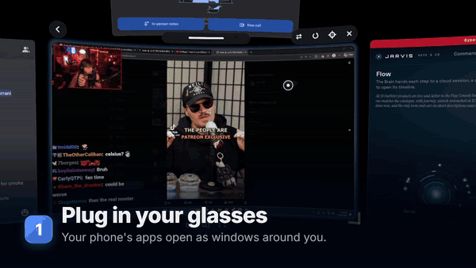

# Pocket XR

**A spatial desktop for XREAL glasses, run from your Android phone.**

Pocket XR turns a phone and a pair of XREAL glasses into a multi-window workspace. Your apps float around you as
windows you can move, resize, curve and push back. Head tracking keeps them in place as you look around, and the
phone becomes a trackpad, a Spatial Mouse you point, or you use your hands.

<p align="center"></p>

<!-- TODO before launch: a link to the full demo video. -->

## What it does

- **Windows in space.** Any Android app opens as a window around you, at its own size and distance. You can drag a
  window by its edge, snap it next to others, curve it, or push it further and pull it closer.
- **All windows at once.** Hold both hands up, or use Adjust all, to move, push, pull or resize every window together.
- **Head tracking.** Windows stay where you put them in the room. It reads the glasses' own motion sensor at 1000 Hz,
  paced to the glasses' display.
- **3D side by side.** Each eye gets its own view, so windows sit at a real depth. Pocket XR switches the glasses
  into 3D by itself where they allow it.
- **Your phone as the controller.** A trackpad, with taps, two-finger scroll and pinch and three-finger swipes; a
  Spatial Mouse you point like a laser; and a scroll strip. On a Galaxy Z Flip it also works on the cover screen.
- **Hand tracking**, on glasses with a camera (the XREAL Aura): point, pinch and drag, with each hand separately.
- **An app launcher, a Control Center** (arrange layouts, presets, Wi-Fi, Bluetooth, quick settings) and **Wide
  view**, which gives phone-shaped apps a landscape screen.

## Supported glasses

| Glasses | Status | Hand tracking |
| --- | --- | --- |
| XREAL Aura | Tested | Yes |
| XREAL One | Tested | No (no camera). Turn **Stabilizer off** in the glasses' menu. |
| XREAL One Pro | Community testing | No, unless a camera is found |
| XREAL 1S | Community testing | No |
| Other glasses | Help wanted | No |

Details, settings for each model and how to report your glasses: [docs/GLASSES.md](docs/GLASSES.md). If you own a
model marked "Community testing", a Glasses report from the app helps a lot (Menu, then Pocket XR Settings, then Advanced, then Glasses report).

## Supported phones

Pocket XR needs a phone whose USB-C port carries video (DisplayPort alt mode) and runs Android 11 or later. It is
developed on a **Samsung Galaxy Z Flip 7** with One UI. Other phones with video out should work; report what you find.

## Setup

1. **Install Pocket XR** from the [Releases](https://github.com/pocket-xr/pocket-xr/releases) page.
2. **Install and start [Shizuku](https://shizuku.rikka.app/)**, and allow Pocket XR in it. Pocket XR uses it to
   create a window for each app and to start the Space on the glasses. Without Shizuku, apps open as ordinary desktop
   windows instead.
3. **Turn on the Pocket XR pointer** in Android's accessibility settings when the app asks. It draws the cursor on the
   glasses and taps where you point. It does nothing on the phone's own screen and sends nothing off the phone.
4. **Plug in the glasses.** The Space opens on them, and the phone shows the trackpad.
5. **On Samsung phones**, if touches at the screen's edges go missing (the scroll strip), turn on Good Lock's Edge Touch
   for the trackpad.

## Updates

Every update is free. There are three ways to get them:

- **In the app.** Pocket XR checks GitHub Releases once a day and shows a card on its phone screen when a newer version
  is out; tap Download. You can turn this off with "Check for updates" on the same screen. The check sends nothing
  about you or your phone: it is a plain request to GitHub's public API.
- **[Obtainium](https://github.com/ImranR98/Obtainium)**, which updates apps straight from their GitHub releases. In
  Obtainium, tap Add App and paste `https://github.com/pocket-xr/pocket-xr`. It then shows each new release and
  installs it with a tap.
- **F-Droid**: a listing is planned.

Updates install over the version you have and keep your windows and settings, as long as they are signed with the same
key. Every official release is, and you can check it: the release key's SHA-256 certificate fingerprint is

```
33:EA:D4:CD:FA:C9:57:16:96:AB:CB:2A:EA:44:65:89:1C:30:ED:1D:82:57:12:78:A4:A5:4B:87:0B:A2:93:AD
```

(`apksigner verify --print-certs pocketxr-x.y.z.apk` shows it; Obtainium and AppVerifier can check it for you).

## Building from source

You need JDK 17, the Android SDK (compile SDK 36) with NDK and CMake 3.22.1, and Gradle 9.5.1.

```bash
gradle :core:test
gradle :app:assembleDebug
```

`core/` is plain Kotlin with no Android dependencies: the window maths, head tracking fusion, gestures and protocol
parsing, with over 1,600 unit tests. `app/` is the Android app. [CONTRIBUTING.md](CONTRIBUTING.md) has the details.

## Contributing

Bug reports, glasses reports and pull requests are welcome. Start with [CONTRIBUTING.md](CONTRIBUTING.md), and look for
issues labelled `good first issue`. Everyone taking part follows the [Code of Conduct](CODE_OF_CONDUCT.md). How the
project is run is in [GOVERNANCE.md](GOVERNANCE.md).

## About

Pocket XR is made by **Mike Haye**, an XREAL supporter since the original Nreal Air, as a free project for everyone who
loves these glasses. I built it for myself with my Aura glasses and the references I could find, then developed it
with Claude, an AI assistant, to the point where the community can run with it. It is written from scratch, and XREAL
has approved its release; it is not made by or affiliated with XREAL. "XREAL" and the glasses'
names are XREAL's trademarks, used here only to say what the app works with.

- **Need something built?** I'm available for XR and Android work: connect@mikehaye.com.

## Support

[](https://ko-fi.com/mikehaye)

Enjoying Pocket XR? You can buy me a beer on [Ko-fi](https://ko-fi.com/mikehaye). It's never required; a star or a
glasses report helps just as much.

## Licence

Pocket XR is free software under the [GNU General Public License v3.0](LICENSE). Third-party credits are in
[docs/LICENSES.md](docs/LICENSES.md). The name "Pocket XR" and its icon are covered by [TRADEMARK.md](TRADEMARK.md):
forks are welcome under another name.
